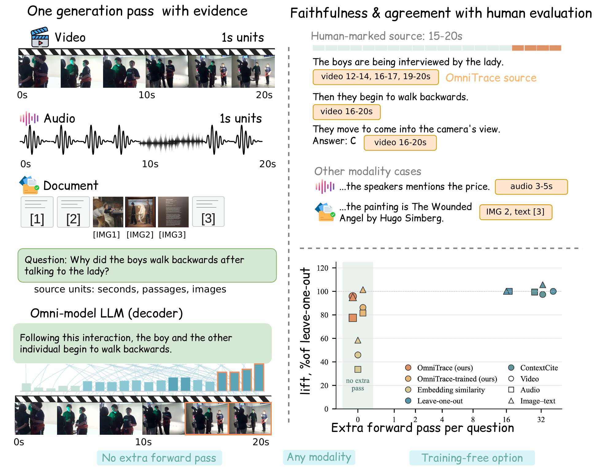
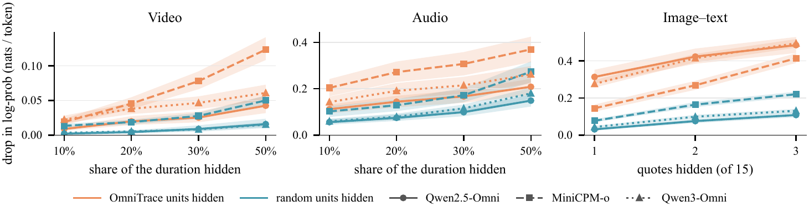
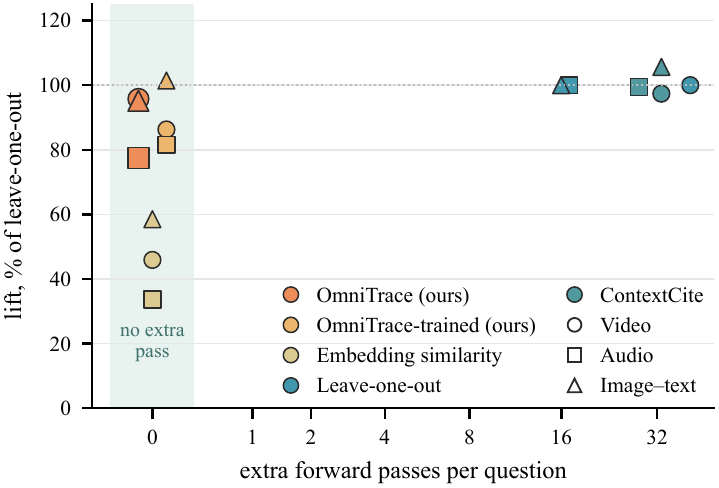
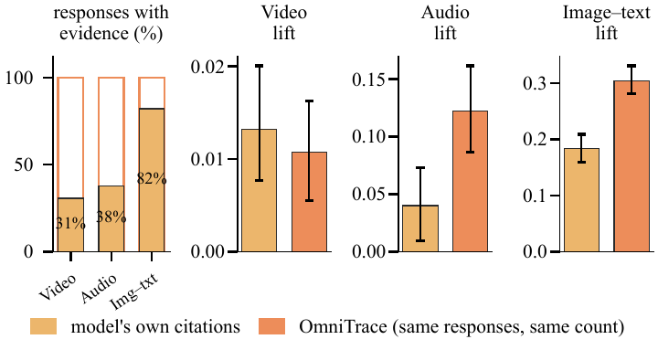

# OmniTrace

Official code for **"OmniTrace: A Unified Framework for Generation-Time Source Attribution in Omni-Modal LLMs"**.

[📜 arXiv](https://arxiv.org/abs/2604.13073) | [🌐 Project page](https://jackie-2000.github.io/omnitrace.github.io/)

<p align="center"></p>

An omni-modal LLM can answer questions about a video, a recording, or a long document. It cannot show which part of the input an answer came from.
- **Asking** the model to cite its evidence tells you what it *says* it used.
- **Measuring** what it *used* has so far meant rerunning it dozens of times with parts of the input removed. Every rerun covers the full clip.

**OmniTrace reads the evidence from the generation pass itself.** For each generated sentence, it sums the late-layer attention that the sentence puts on each **source unit**: one second of video, one second of audio, a text passage, or an image. Units that stand out within their own modality are returned as evidence: time intervals for audio and video, quote ids for documents.

- **One pass.** No extra forward pass, no backward pass, no training. Every sentence gets its sources while the answer is generated.
- **Any modality.** Video, audio, images, and text are handled by one rule with one setting, on three models: Qwen2.5-Omni-7B, MiniCPM-o 4.5, and Qwen3-Omni-30B-A3B.
- **Tested, not assumed.** We hide units at the encoder input behind content-free placeholders (black frames, silence, blank tokens) and replay the model's own response. The units OmniTrace picks matter more than random units in all 9 model × modality settings. OmniTrace recovers 77–96% of the effect of leave-one-out, which needs 16–41 extra passes.

## How it works

1. **Source units.** The input is cut along structure it already has: ~1-s units for video and audio, following the encoder's own time grid, and one unit per text passage or image. The question, the options, and the template are never candidates.
2. **Attention mass.** At every generated token, attention is averaged over all heads of the last third of the decoder layers. A unit's score for a sentence is the attention mass the sentence's tokens put on it:
   $s_k(S_j)=\sum_{t\in C_k}\sum_{i\in S_j} a_t(i)$.
   The score adds up over tokens, so the response score is the sum of the sentence scores. Hard tracing that follows argmax *peaks* breaks on continuous inputs: one second of video spans hundreds of positions, each with little weight. The second as a whole can still hold the mass.
3. **Labels.** A unit is labelled when its score is at least τ = 1.5 times the mean of the other units of the same modality. Flat scores give no label, so the sentence abstains.

**OmniTrace-trained** (optional) learns one weight per attention head from ablation data, still in one pass at test time. The released code covers the training-free default.

## Results

Lift is the extra drop in the log-probability of the model's own response when a method's top units are hidden, compared with hiding the same number of random units (nats/token; 20% of the duration for video and audio, 2 of 15 quotes for documents). S-lift and S-spec are the same test for single sentences: S-lift compares with random units, S-spec with the other sentences. Fwd counts the extra forward passes per question. Baselines run on Qwen2.5-Omni-7B.

| Method | Video Fwd | Video Lift | Video S-lift | Audio Fwd | Audio Lift | Audio S-lift | Doc Fwd | Doc Lift | Doc S-lift |
|---|---:|---:|---:|---:|---:|---:|---:|---:|---:|
| Embedding similarity | 0 | 0.008 | 0.009 | 0 | 0.034 | 0.031 | 0 | 0.216 | 0.216 |
| Self-citation | 1 | 0.013 | 0.012 | 1 | 0.040 | 0.036 | 1 | 0.184 | 0.349 |
| Leave-one-out* | 41 | 0.016 | 0.024 | 17 | 0.100 | 0.133 | 16 | 0.368 | 0.404 |
| ContextCite* | 33 | 0.016 | 0.027 | 28 | 0.099 | 0.139 | 33 | 0.389 | 0.397 |
| **OmniTrace** · Qwen2.5-Omni-7B | **0** | 0.016 | 0.015 | **0** | 0.077 | 0.110 | **0** | 0.351 | 0.376 |
| **OmniTrace-trained** · Qwen2.5-Omni-7B | **0** | 0.014 | 0.016 | **0** | 0.081 | 0.116 | **0** | 0.374 | 0.385 |
| **OmniTrace** · MiniCPM-o 4.5 | **0** | 0.024 | 0.027 | **0** | 0.136 | 0.102 | **0** | 0.105 | 0.159 |
| **OmniTrace-trained** · MiniCPM-o 4.5 | **0** | 0.067 | 0.065 | **0** | 0.169 | 0.120 | **0** | 0.432 | 0.706 |
| **OmniTrace** · Qwen3-Omni-30B-A3B | **0** | 0.033 | 0.032 | **0** | 0.112 | 0.095 | **0** | 0.316 | 0.448 |

\*Defined for text in the original work. Here they run on audio, video, and images with OmniTrace's units and placeholders.

<p align="center"></p>
<p align="center"><em>Hiding the units OmniTrace selects (orange) hurts the response more than hiding random units (blue), at every budget, in every modality, on every model. Bands are 95% bootstrap intervals.</em></p>

<p align="center">&nbsp;</p>
<p align="center"><em>Left: faithfulness (share of leave-one-out's lift) against extra forward passes. Right: when asked to cite, the model often gives no citation for audio and video, and the units it cites matter less than OmniTrace's units of the same count.</em></p>

OmniTrace also agrees best with human-marked evidence. Its response-level ranking reaches an AUROC of 0.83 on documents and 0.64 on video. The strongest baseline reaches 0.76 and 0.60.

## Installation

Each model family pins a different `transformers` version, so use one environment per model:

```bash
git clone https://github.com/UCSB-AI/OmniTrace.git && cd OmniTrace

# Qwen2.5-Omni-7B (default)
conda create -n omnitrace python=3.10 -y && conda activate omnitrace
pip install -r requirements.txt && python -m spacy download en_core_web_sm

# MiniCPM-o 4.5 (transformers 4.51)
conda create -n omnitrace-minicpm python=3.10 -y && conda activate omnitrace-minicpm
pip install -r requirements_minicpm.txt && python -m spacy download en_core_web_sm

# Qwen3-Omni-30B-A3B (transformers 4.57.1)
conda create -n omnitrace-qwen3 python=3.11 -y && conda activate omnitrace-qwen3
pip install -r requirements_qwen3.txt && python -m spacy download en_core_web_sm
```

Optionally, run `pip install -e .` to import `omnitrace` from anywhere. A CUDA GPU is needed (Qwen2.5-Omni-7B: about 25–35 GB per process in bf16). Models are placed with `device_map="auto"`, so a large model can span several GPUs.

## Quick start

### Python API

```python
from omnitrace import OmniTrace

ot = OmniTrace("qwen2.5-omni-7b")          # or "minicpm-o-4.5", "qwen3-omni-30b-a3b"

out = ot.trace({
    "question": "Why did the boys walk backwards after talking to the lady?",
    "options": ["walk to the tent", "show his garden", "to come in the camera",
                "convince girl to do something", "give spotlight to boy in yellow"],
    "sources": [{"sid": "v0", "modality": "video", "path": "examples/media/3487251005.mp4"}],
})

print(out["response"])
for s in out["sentences"]:
    print(s["text"], "<-", s["spans"] or s["sources"] or "(no source)")
# 3. Following this interaction, the boy and the other individual begin to walk backwards. <- {'v0': [[16.25, 20.312]]}
# (human-marked evidence for this question: 15.9-20.0 s; output of Qwen2.5-Omni-7B in our run)
```

Each sentence comes with:
- `scores`: the attention mass on every unit, indexed by `out["units"][i]["uid"]`.
- `units`: the labelled unit ids.
- `spans`: merged time intervals per audio or video source.
- `sources`: the labelled quote and image ids.

`out["response_attribution"]` gives the same fields for the whole answer. If you leave out `options`, the question is asked open-ended.

### Demo on the bundled examples

`examples/questions.json` holds one video (NExT-GQA), one audio (MMAU), and one document (MMDocRAG) question, with their media. These are the examples shown on the project page.

```bash
python scripts/demo.py                                   # all three, Qwen2.5-Omni-7B
python scripts/demo.py --only audio --model qwen3-omni-30b-a3b
python scripts/demo.py --questions my_questions.json --data_root /path/to/media --out out.json
```

### Input format

Each input is one JSON object. Relative `path`s resolve against `data_root`, or against `$OMNITRACE_DATA` in the batch scripts.

```jsonc
// video or audio, multiple choice (one media source per question)
{"id": "q1", "question": "What sport is the first speaker getting a scholarship for?",
 "options": ["Basketball", "Soccer", "Baseball", "Softball"], "answer_idx": 3,
 "sources": [{"sid": "a0", "modality": "audio", "path": "media/clip.wav"}]}

// documents: text passages and images as quotes, long answer
{"id": "q2", "task": "long_qa", "question": "What is the gender distribution among senior leadership ...?",
 "sources": [{"sid": "text1", "modality": "text", "text": "..."},
             {"sid": "image1", "modality": "image", "path": "media/page_chart.jpg"}]}
```

Optional fields used by evaluation:
- `evidence`: human evidence, as `[{"sid", "spans": [[start_s, end_s], ...] | null}]`.
- `answer`: the reference answer.
- `duration` on a source.

## Reproducing the paper

**Data.** `data/` holds the three evaluation sets (949 questions) in the input format:
- `question_video.json`: NExT-GQA, 300 questions.
- `question_audio.json`: MMAU, 249 questions.
- `question_image_text.json`: MMDocRAG, 400 questions.

Media are not redistributed. [`data/README.md`](data/README.md) says where to download them and where to put each file.

**Generation + attribution.** One shard per GPU. The scripts resume where they stopped, and records go to `runs/<dataset>/<model>/`.

```bash
export OMNITRACE_DATA=$PWD/data NGPU=4
bash scripts/run_nextgqa.sh smoke          # 5 questions: check the setup first
bash scripts/run_nextgqa.sh full           # video
bash scripts/run_mmau.sh full              # audio
bash scripts/run_mmdocrag.sh full          # documents
MODEL=minicpm-o-4.5 bash scripts/run_mmau.sh full        # other models: same commands, in their environment
```

**Causal test.** Each script hides OmniTrace's top units and size-matched random units, replays the saved response with teacher forcing, and prints the summary: lift, keep gain, sentence lift and specificity, and label rows, all with 95% bootstrap intervals.

```bash
bash scripts/run_nextgqa.sh causal         # video: 10/20/30/50% of the duration, black frames
bash scripts/run_mmau.sh causal            # audio: silence
bash scripts/run_mmdocrag.sh causal        # documents: 1/2/3 of 15 quotes, black image / blank tokens
SETTINGS="mass v1" bash scripts/run_mmau.sh causal       # also test argmax tracing + curation
```

**Agreement with human evidence** (CPU, from the saved records and traces):

```bash
python scripts/eval_temporal.py --run runs/nextgqa/qwen2.5-omni-7b --questions data/question_video.json
python scripts/eval_doc.py      --run runs/mmdocrag/qwen2.5-omni-7b --questions data/question_image_text.json
python scripts/label_stats.py   --run runs/mmdocrag/qwen2.5-omni-7b --questions data/question_image_text.json
```

**Output.** Each line of `records*.jsonl` holds:
- the response and the parsed answer;
- the source units (`units`, with times);
- per sentence and for the whole response, the attention mass on every unit and the labels (`attribution.attention`).

`traces/<id>.npz` stores the per-token, per-layer attention mass on each unit and the generated ids. Any layer setting can be recomputed from it on CPU, and the causal test replays it without generating again.

## Test your own attribution method

The causal test works with any method that ranks the same units. For each question, write one line to `runs/<dataset>/<model>/baselines/<name>.jsonl`:

```json
{"id": "<question id>", "method": "<name>", "kind": "scores",
 "response": [/* one score per unit uid */], "sentences": [[/* ... */], ...], "cost": {"forward": 0}}
```

Then score it next to OmniTrace with the same hiding operation and the same random draws:

```bash
python scripts/causal_audio.py run --run runs/mmau/qwen2.5-omni-7b --questions data/question_audio.json \
    --settings mass ext:<name> --tag mine
python scripts/causal_audio.py summarize --run runs/mmau/qwen2.5-omni-7b --tag mine
```

A method that returns a set of units with no ranking, such as cited spans, uses `"kind": "set"` with `--ext_sets <name>`. It is compared with random units and with OmniTrace's top units of the same count. The interface is documented in `omnitrace/external.py`.

## Repository layout

```
omnitrace/                 the library
  api.py                   OmniTrace(model).trace(sample)
  evidence.py              attention mass per unit, labels (select_units), settings on saved traces
  capture.py               attention capture during generation (last query row, SDPA)
  timeline.py, segment.py  input positions -> source units; response -> sentences
  ablation.py              content-free placeholders for the causal test
  external.py              plug-in interface for other attribution methods
  backends/                Qwen2.5-Omni, MiniCPM-o 4.5, Qwen3-Omni-30B-A3B
scripts/
  run_attribution.py       batch generation + attribution (records, traces)
  causal_{video,audio,doc}.py   causal test (GPU) and summaries (CPU)
  eval_temporal.py, eval_doc.py, label_stats.py, tau.py   agreement with human evidence, label threshold
  run_{nextgqa,mmau,mmdocrag}.sh   launchers (smoke / full / causal)
  demo.py                  the bundled examples
configs/label_tau.json     label threshold per modality (1.5 for all)
data/                      evaluation question files (media: see data/README.md)
examples/                  three example questions with media
```

## Citation

```bibtex
@misc{yan2026omnitrace,
  title         = {OmniTrace: A Unified Framework for Generation-Time Source Attribution in Omni-Modal LLMs},
  author        = {Qianqi Yan and Yichen Guo and Ching-Chen Kuo and Shan Jiang and Hang Yin and Yang Zhao and Xin Eric Wang},
  year          = {2026},
  eprint        = {2604.13073},
  archivePrefix = {arXiv},
  primaryClass  = {cs.CL},
  url           = {https://arxiv.org/abs/2604.13073}
}
```

## License

MIT (see `LICENSE`). The example media come from NExT-GQA (VidOR), MMAU, and MMDocRAG and keep the licenses of those datasets.
